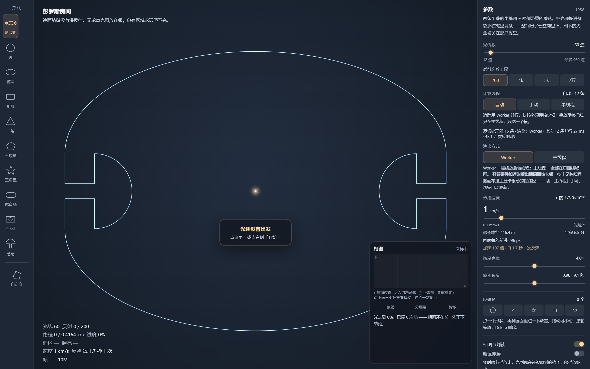
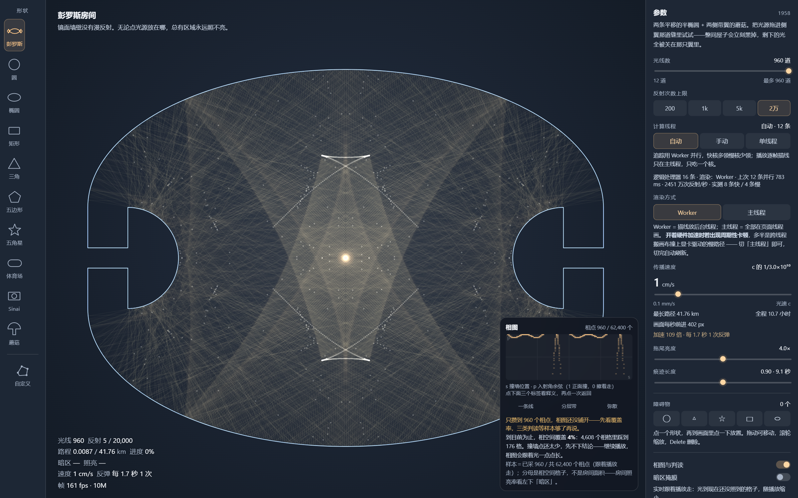
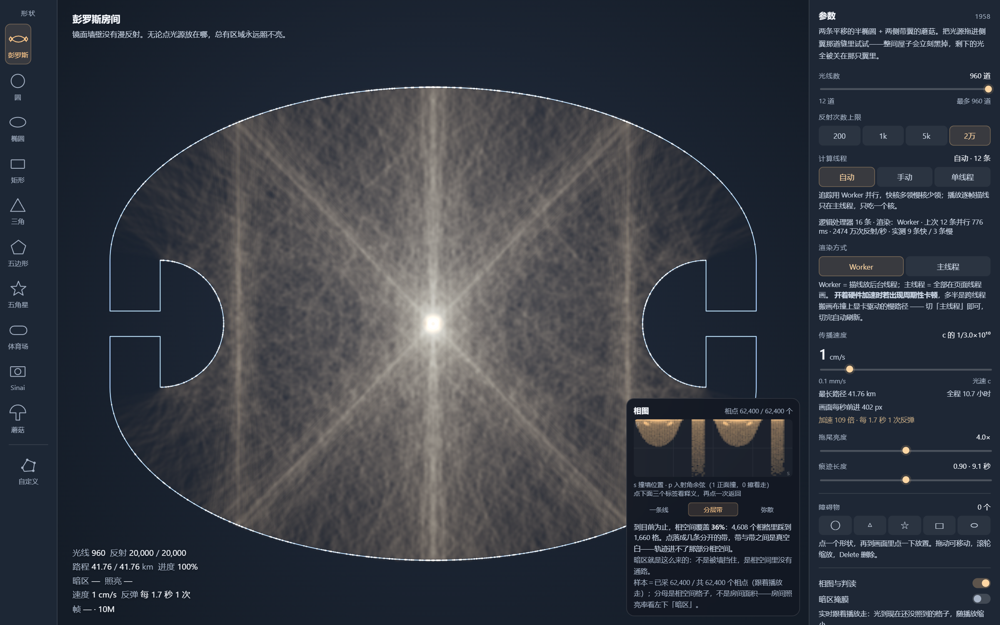
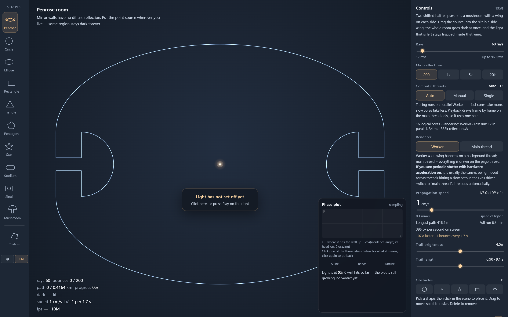
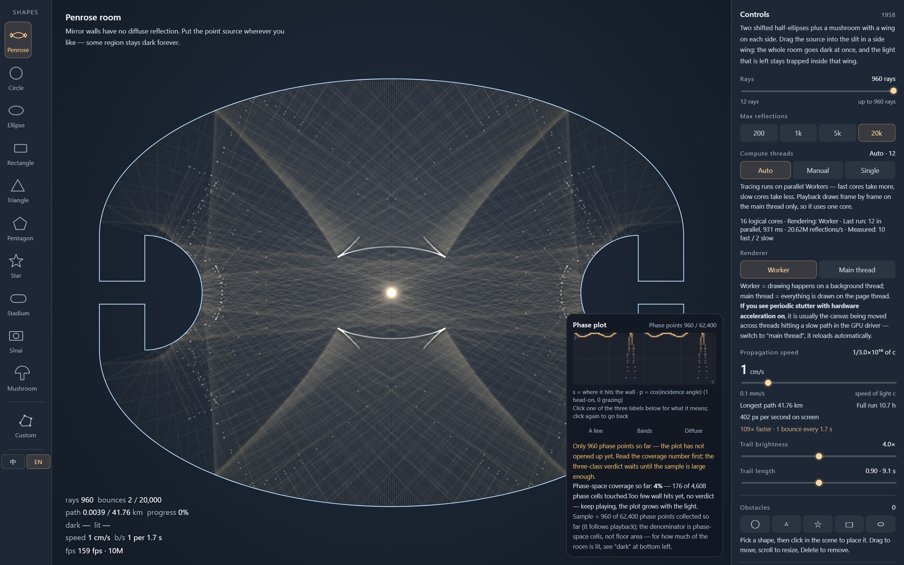

# 镜室 · 光线与台球动力学

**一个 HTML 文件，把 1958 年彭罗斯那个「照不亮的房间」变成可以拖、可以量、可以切十个房间的动力学实验室。**

零依赖，双击即用。没有构建、没有 npm、没有 `node_modules`。

> **这是一个个人兴趣项目。** 没有 roadmap、没有 issue 模板、不承诺响应时间。代码是按「自己用着舒服」的标准写的，不是按通用库的标准写的——**界面是中英双语（左侧栏最下面一组「中 / EN」按钮，随时切换，选择记在本机）**，注释是中文，默认参数也是照我自己这台机器调的。

> **English summary** — A single-file, zero-dependency 2D mirror billiard laboratory: ten rooms including Penrose's 1958 unilluminable room, real-time dark-region masks, and Poincaré phase-space analysis. Open the HTML file in a browser; no build, no server, no dependencies. Full English README: [`README.en.md`](README.en.md).

---

## 它是什么

二维镜面台球（mathematical billiard）的交互实验台。光从一点出发，在完美镜面墙上做镜面反射，永不衰减。你可以换房间形状、拉光线数、加到两万次反射、往屋里扔障碍物，然后同时看两件事：

- **真实空间**：哪块区域光到了，哪块永远到不了（暗区掩膜），以及焦散的密度骨架（曝光图）
- **相空间**：每撞一次墙记一个点，横轴是撞墙位置、纵轴是入射角的余弦，看轨迹在相空间里到底占了一维的线、二维的带，还是整片

这两张图回答同一个问题的两面：**这个房间里的光，最后到底能不能铺满？**

界面中英双语：左侧栏底部一组「中 / EN」按钮，随时切换，选择记在本机（`localStorage`），刷新后保持。**切语言只换文字**——几何、追踪结果、播放进度、暗区掩膜一概不动，你拉满的 960 道 × 2 万次也不会被打回默认值。











---

## 仓库里有什么

| 文件 | 作用 | 必须和 html 放一起？ |
|---|---|---|
| `penrose-room.html` | 全部内容（约 4900 行，190 KB，界面中英双语） | — |
| `打开镜室-干净浏览器.cmd` | Windows 启动器：用独立配置的干净浏览器窗口打开它 | **是** |
| `README.md` / `README.en.md` | 中文 / 英文说明 | 否 |
| `简介.md` | 几种长度的介绍文案（中英都有） | 否 |
| `screenshots/` | 五张首屏图（三张中文界面 + 两张英文界面） | 否 |

**`penrose-room.html` 和 `打开镜室-干净浏览器.cmd` 要放在同一个文件夹里。** 启动器是用「自己所在的目录」拼网页路径的（`%~dp0penrose-room.html`），挪开就找不到文件。

整个仓库只有这两个是运行必需的。删掉 `.cmd` 照样能直接双击 html 用，只是会失去下面说的性能优势。

---

## 和网上那些的区别

这个题材不新。彭罗斯房间是 1958 年的经典结果，网上能搜到不少实现。但真正能拿来「测量」的很少：

| 项目 | 形状数 | 实时轨迹 | 真实空间暗区 | 相空间分析 | 规模 | 依赖 |
|---|---|---|---|---|---|---|
| **镜室（本项目）** | **10 + 自定义 + 障碍物** | **实时，可调速** | **实时掩膜 + 曝光密度场** | **Poincaré 截面 + 覆盖率 + 三分类** | **960 道 × 2 万次 = 1920 万次反弹** | **单文件，零依赖** |
| [PhyDemo Ray Optics](https://phydemo.app/ray-optics/) | 通用光学器材 | 有 | 无（靠肉眼数光线） | 无 | 数百条 | 网页应用 |
| [Wolfram：The Penrose Unilluminable Room](https://demonstrations.wolfram.com/ThePenroseUnilluminableRoom/) | 1（仅彭罗斯） | 无（静态明暗图） | 有，一次性算出 | 无 | 固定 | Wolfram Player |
| [tellurion.dev 台球 playground](https://tellurion.dev/playgrounds/bsc-y2s2/FIS2021-billiards-circle-stadium-sinai/index.html) | 3（圆/体育场/Sinai） | 有 | 无 | 只有孪生轨道分离曲线 | 数百条 | 网页 |
| [Stadium Billiards (CindyJS)](https://maxthematics.github.io/illustrating-math/stadium-billiards) | 1（仅体育场） | 有 | 无 | 无 | ≤1000 条 | 网页 |
| [Quantum Billiards (Emergent Mind)](https://www.emergentmind.com/visualizations/quantum-billiards) | 5 | 有（配角） | 无 | Husimi（量子侧） | 波包 | 网页 |
| GitHub `penrose-unilluminable-room` 系列 | 1 | 有 | 多数无 | 无 | 很小 | 各自不同 |

三点差别最实：

1. **别人做一个房间，这里做十个。** 可积（圆、椭圆、矩形）、有理角（三角、五边形、五角星）、混沌（体育场、Sinai）、混合相（蘑菇）、彭罗斯——同一个界面里横向对比，参数一致，判据一致。
2. **暗区不是画出来的一张图，是算出来的实时状态。** 掩膜跟着播放进度长：光走到哪，暗区缩到哪。不是「先算完再贴一张蒙版」。
3. **相空间是真的在读数，不是示意图。** 每个点都是某道光的某一次真实撞墙（位置 + 入射角 + 路径弧长），覆盖率的分母是相空间格数，写得清清楚楚。

顺便说一句现状：GitHub 上 `penrose unilluminable room` 搜出来 5 个仓库，星标最多 1 个；`billiard simulation` 的高星仓库全是「斯诺克/八球物理引擎」，跟数学台球不是一回事。**这个细分题材目前没有成熟的可交互作品**——这也是我把它开源的原因。

---

## 十个房间

| 房间 | 类别 | 一句话 |
|---|---|---|
| 彭罗斯 | 1958 | 两条平移的半椭圆 + 两侧带翼的蘑菇，无论光源在哪总有照不到的地方 |
| 圆 | 可积 | 每次撞墙的入射角恒定，轨道困在同心焦散上 |
| 椭圆 | 可积 | 过一个焦点的光，反射后必过另一个焦点 |
| 矩形 | 可积 | 轨迹要么周期，要么铺成整齐的平行网格 |
| 三角 | 有理角 | 没有指数发散，但照样铺满整屋 |
| 五边形 | 有理角 | 同上，正五边形版本 |
| 五角星 | 有理角 | 非凸，尖角把光反复折回，最容易出焦散 |
| 体育场 | 混沌 | 把矩形的直边换成半圆，可积立刻变混沌 |
| Sinai | 混沌 | 中央一根圆柱，把矩形的可积性彻底破坏 |
| 蘑菇 | 混合 | 帽里是混沌海，茎里困着规则岛——光进不去也出不来 |

此外可以：

- 往屋里扔**障碍物**（圆 / 三角 / 五角星 / 矩形 / 椭圆），拖动、滚轮缩放、Delete 删除
- 用**自定义多边形**：拖顶点改外框、点边上青点加顶点、双击顶点删除

---

## 怎么读屏幕上那两个百分比

这是整个项目最容易误会的地方，所以我把它写在界面上：

| 数字 | 分母 | 含义 |
|---|---|---|
| 左下「暗区」 | **实空间的房间格子** | 光到现在还没照到的房间面积占比 |
| 右下「相空间覆盖率」 | **相空间的格子**（96 × 48 = 4608） | 撞墙事件在 (s, p) 平面上踩到了多少格子 |

**两者天然不相等，也不该相等。** 圆屋只照亮 4.8% 的房间，却可能在相空间里踩掉一大片格子——因为它虽然只覆盖一个小环带，但每一条轨道都以不同角度、不同位置反复撞墙。

同一个界面里，左边的暗区掩膜是「房间的地图」，右边的相图是「撞墙事件的地图」。混着看会以为有 bug，其实是两个坐标系。

---

## 数学：我们量过什么

不是「看着对」，是逐条对过账。下面这些数字来自仓库内的不变量审计脚本，每一项都是用一个**独立写一遍的物理循环**（不调用内核自己的追踪函数）逐条核对的：

| 不变量 | 结果 |
|---|---|
| 反射后方向向量仍为单位向量 | 偏差 ≤ 1e-9 |
| 圆台球：`\|d·n\|` 守恒（等价于同心焦散半径 R·cosα） | 漂移 **6.3e-14** |
| 椭圆台球：焦散参数 `λ = a²dy² + b²dx² − (x·dy − y·dx)²` 守恒 | 相对漂移 **4.9e-14** |
| 矩形台球：竖壁 / 横壁碰撞次数比 vs 解析预测 | 差 **0.05%** |
| 彭罗斯房间：左右镜像对称偏差 | **0.0** |
| 椭圆相图横轴：参数角 → 弧长换算 | 最大偏差 5.6e-5（0.006% 片长） |
| 弧长定位（粗表二分）vs 暴力线性扫描 | 位置差 **0.0** |
| 落点残差 / 零长度反弹 / NaN | 10 场景 × 200 道 × 3000 次，全部为 0 |

**判读不是随口说的。** 相图分三类（一条线 / 分层带 / 弥散）有两个硬闸门：

- 采样点数 ≥ 1.5 倍相格数
- 光线数 ≥ 240

达不到就只报覆盖率、不下结论，理由是：60 条轨迹在 96×48 的相图里只是 60 条一维曲线，覆盖率主要由**道数**决定，跟「是不是遍历」关系不大。这一条是被实测数据逼出来的——同一形状 60 道 28%、240 道 68%、960 道 93%，跟物理无关，只跟样本量有关。

---

## 工程：一个文件怎么跑起来

```
penrose-room.html          ← 全部内容（约 4600 行，含内核、渲染、界面）
├─ trace kernel（共享源码，物理上只有一份）
│   ├─ 主线程 Blob Worker  → 多线程追踪（默认）
│   └─ new Function 就地造  → Worker 不可用时单线程回退
├─ render kernel（Worker + OffscreenCanvas 描线、衰减、密度累积）
└─ 主线程（合成、掩膜、相图、UI）
```

几条硬约束，都是踩过坑之后定的：

- **内核只写一份。** 追踪内核的源码同时供 Worker 和主线程回退使用，不会出现「两条实现算出两种结果」。
- **画布转移是单向的。** `transferControlToOffscreen()` 之后主线程再也画不了那张画布，所以起 Worker 前先用 `new Function` 编译一遍内核源码——语法错留到 Worker 里报就是异步的，那时画面会静默变空白。
- **参数不骗人。** 设了 2 万次反射就真按 2 万次算，面板显示的数字来自实际追踪结果，不是估算。
- **视图变化不重追物理。** 追踪结果只取决于几何、光源、光线数、反射上限，跟画布尺寸无关；拖窗口只重绘，不重算。

性能参考：16 线程机器上，960 道 × 2 万次（1920 万次反弹）一轮追踪在 1 秒量级，HUD 面板实测约 2300 万次反弹/秒。

---

## 上手

1. 把 `penrose-room.html` 和 `打开镜室-干净浏览器.cmd` 放进同一个文件夹
2. **Windows**：双击 `.cmd`（推荐），或直接双击 `.html`
3. 左边选房间，右边调参数，点「开始」
4. 想拉满：光线数拉到 960，反射上限点「2万」

界面上的数字：

- **左下 HUD**：光线数、反射次数、路程、进度、暗区、照亮、速度、反弹率、帧率。点一下 HUD 会跑 3 秒性能自检。
- **右下相图卡**：相点数、覆盖率、三类判读，点下面三个标签看释义。
- **传播速度**：从 0.1 mm/s 到光速，是「物理速度 × 显式倍率」，不是固定几秒跑完。

---

## 为什么建议用启动器：一个实测出来的差异

直接双击 `penrose-room.html`，大多数时候能正常跑。但我自己在 Windows 上实测到一件事：

> **同一次拉满参数（960 道 / 2 万次），直接双击打开会掉帧；用启动器单独开一个窗口就很流畅。**

排查下来，原因不在这个页面，也不在 `file://`：

| | 直接双击 | 启动器 |
|---|---|---|
| 浏览器配置 | 你日常那个（扩展、侧边栏、十几个标签） | 全新独立配置，第一次启动是空的 |
| 扩展脚本 | 会往页面里注入内容脚本 | `--disable-extensions`，一个都没有 |
| 合成器 | 扩展弹窗、侧边栏、其他标签的叠加层都参与每帧合成 | 独立进程树 + 独立 GPU 进程，没有叠加层 |
| 窗口 | 带地址栏和标签栏 | `--start-fullscreen` 全屏无边框 |

这个页面每帧要合成三层（背景 + 拖尾 + 曝光密度图），对合成器叠加层特别敏感。日常浏览器里那些看似无关的扩展面板，会让每帧多出几次全屏混合——帧率就是这么掉下去的。

启动器只做了一件事：**换一个干净环境**，没有改页面本身。

- `--user-data-dir=%LOCALAPPDATA%\PenroseRoom.Profile` — 独立配置目录，跟你日常浏览器互不干扰
- `--disable-extensions --no-first-run --no-default-browser-check` — 空配置、无扩展、不弹首次引导
- `--start-fullscreen --start-maximized` — 全屏

**所以：直接打开能跑，只是性能不一定在最佳状态；想跑满参数，用启动器。**

反过来说，这不是「必须用启动器」——如果你的浏览器本来就很干净（无痕窗口、没装扩展），直接双击一样流畅。

---

## 跨平台：网页是通用的，启动器不是

| | `penrose-room.html` | `打开镜室-干净浏览器.cmd` |
|---|---|---|
| Windows | ✅ | ✅ 双击即用 |
| macOS | ✅ 双击，用默认浏览器打开 | ❌ `.cmd` 是 Windows 批处理，macOS 不认识 |
| Linux | ✅ 双击或 `xdg-open` | ❌ 同上 |
| 手机 / 平板 | 能打开，但界面按桌面设计，不适合 | ❌ |

**网页本身完全通用。** 它只用 HTML5 的 Canvas、Web Worker、OffscreenCanvas，没有平台相关代码，也没有任何外部资源。

浏览器支持（画布跨线程转移 `transferControlToOffscreen`，三大引擎自 2023 年 3 月起都已支持）：

| 浏览器 | 版本 | 表现 |
|---|---|---|
| Chrome | 69+ | 完整，默认走 Worker 渲染 |
| Edge | 79+ | 完整 |
| Firefox | 105+ | 完整；启动器会自动识别，但 Firefox 没有全屏参数，按一次 F11 后该配置会记住 |
| Safari | 16.4+ | 完整 |
| 更老的浏览器 | — | 自动回退到主线程渲染，能跑，帧率低一些 |

### macOS 上想要同样的「干净窗口」

`.cmd` 用不了，但同样的效果可以自己开。终端里跑一行（路径换成你的实际位置）：

```bash
open -na "Google Chrome" --args \
  --user-data-dir=/tmp/penrose-profile \
  --no-first-run --disable-extensions --start-fullscreen \
  "file:///Users/你的用户名/Downloads/penrose-room.html"
```

`open -na` 是「新开一个实例」，`--user-data-dir` 给个临时目录就行，删掉不影响任何东西。

Safari 没有对应的启动参数，最接近的做法是「文件 → 新建无痕窗口」（无痕窗口默认不带扩展）。

> 这部分只是说明，仓库里不提供 macOS 启动脚本。原因很实在：我没有 Mac 可以测，放个没验证过的脚本进仓库，比让你手动跑一行命令更容易出错。

---

## 已知边界

- **二维、几何光学。** 没有衍射、干涉、偏振。所以它不能回答「波长级别会发生什么」，只能回答「光线怎么走」。
- **完美镜面。** 没有吸收、没有散射、没有粗糙度。
- **掩膜精度是一个格子。** 格子大小由房间包围盒和 460×340 网格决定，最小暗区要大于一格才会显示。
- **彭罗斯的「照不亮」是几何结论，不是数值结论。** 数值上只要跑得够久，总有零星光子能摸到暗区边角——这是离散采样和连续数学的差别，不是 bug。
- **性能跟浏览器环境强相关。** 同一个文件、同一组参数，干净窗口和日常窗口能差出几倍帧率（见上面「为什么建议用启动器」）。报告性能问题前，请先说明用的是哪种窗口。

---

## 发布信息

**仓库**：<https://github.com/abc1317679842-ui/mirror-room>

**License**：MIT，见 [`LICENSE`](LICENSE)。版权行写的是 `Mirror Room contributors`，想署自己的 GitHub ID 直接改那一行。

**About（中文，≤160 字符）**：
> 单文件零依赖的二维镜面台球实验室：10 个房间、实时暗区掩膜、相空间分析。彭罗斯 1958 年「照不亮的房间」的可测量版本。

**About（English，≤160 chars）**：
> Single-file, zero-dependency 2D mirror billiard lab: 10 rooms, real-time dark-region masks, Poincaré phase space. A measurable take on Penrose's 1958 unilluminable room.

**Topics**（GitHub 只认英文；中文词留给搜索引擎和介绍文案）：
`billiards` `dynamical-systems` `chaos` `ergodic-theory` `penrose` `illumination-problem` `unilluminable-room` `poincare-section` `phase-space` `caustics` `raytracing` `mathematical-visualization` `canvas` `single-file` `no-dependencies` `bilingual` `chinese` `webgl-free`
→ 对应的中文搜索词：镜面台球 / 数学台球 / 彭罗斯房间 / 不可照亮的房间 / 动力系统 / 相空间 / 混沌 / 焦散 / 光线追踪

仓库结构（就是现在这样）：

```
mirror-room/
├── penrose-room.html              ← 主文件，全部内容在这一个里
├── 打开镜室-干净浏览器.cmd         ← Windows 启动器（必须和 html 同目录）
├── README.md                      ← 中文说明
├── README.en.md                   ← English
├── 简介.md                        ← 几种长度的介绍文案（中英都有）
├── LICENSE                        ← MIT
└── screenshots/                   ← 01 初始 / 02 运行中 / 03 完成 / 04-05 英文界面
```
